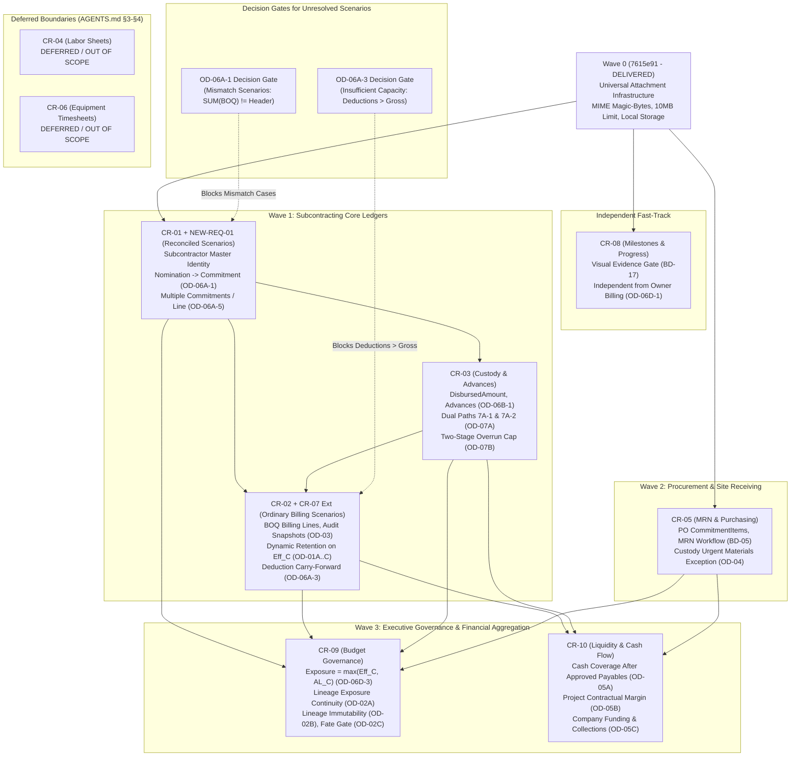

# CR-01 → CR-10 Execution Readiness Roadmap

**Document Version:** `v1.0 — 2026-10-31`
**Governance Status:** Planning & Implementation Readiness Artifact (Owner Review Draft)
**Repository Baseline:** Branch `wave-0` @ Commit `699a696` (`docs: sync approved owner decisions`), following `7615e91` (`feat(wave-0): universal attachment infrastructure`) and `e236aa7` (`feat(slice-21): concurrency hardening`)
**Primary Authoritative References:**
- [AGENTS.md](file:///d:/Construction%20Control/AGENTS.md) (Project-Level Engineering Contract v1.2.0)
- [docs/CR01_CR10_SPEC_CLOSURE_GATE_REPORT.md](file:///d:/Construction%20Control/docs/CR01_CR10_SPEC_CLOSURE_GATE_REPORT.md) (`v2.0 — 2026-10-31`)
- [docs/DESIGN_ADDENDUM_CR01_CR10_FINAL.md](file:///d:/Construction%20Control/docs/DESIGN_ADDENDUM_CR01_CR10_FINAL.md) (`v2.0 — 2026-10-31`)
- [docs/OWNER_DECISION_BRIEF_CR01_CR10.md](file:///d:/Construction%20Control/docs/OWNER_DECISION_BRIEF_CR01_CR10.md) (`v2.0 — 2026-10-31`)
- [docs/CR_Impact_Architecture_Review.md](file:///d:/Construction%20Control/docs/CR_Impact_Architecture_Review.md) (CR-01–CR-10 Architectural Foundation)

---

## Section A — Purpose and Governance

### A.1 Purpose of this Roadmap
This document establishes an authoritative, evidence-based, and dependency-aware technical roadmap for transitioning Change Requests **CR-01 through CR-10** from approved business specifications into controlled, verifiable software implementation.

Following the completion of the specification synchronization gate on 2026-10-31 (committed in `699a696`), the repository baseline possesses verified, Owner-approved business policies across the major operational domains of the Construction Control system. However, requirements approval does not constitute implementation authorization, nor does high-level functional agreement mean that every edge case is coded or ready to be coded.

This roadmap:
1. **Inventories Readiness:** Establishes the exact evidence-based readiness state of each CR and each supporting feature.
2. **Isolates Open Decisions:** Identifies the precise sub-rules, technical alignments, and infrastructure choices that remain unresolved and must be decided before specific code branches are written.
3. **Enforces Boundaries:** Protects non-negotiable architectural boundaries, strictly separating in-scope financial management controls from deferred features (CR-04 and CR-06).
4. **Governs Sequences:** Formulates a realistic, dependency-aware delivery sequence so downstream financial ledgers are not constructed before upstream identity and transaction primitives exist.
5. **Defines Gates:** Imposes a strict Definition of Ready (DoR) before coding begins and an uncompromising Definition of Done (DoD) before any implementation slice can be merged.

### A.2 Governance Rules and Authority Hierarchy
This roadmap is governed by the following strict rules:
1. **Planning Artifact Only:** This document is a technical planning and sequencing artifact. It does **not** alter, replace, or supersede the approved project specifications (`AGENTS.md`, `DESIGN_ADDENDUM_CR01_CR10_FINAL.md`, and `OWNER_DECISION_BRIEF_CR01_CR10.md`).
2. **Authority Hierarchy:** In any case of conflict or ambiguity, the authoritative hierarchy is:
   $$\text{AGENTS.md} \succ \text{Approved Owner Decisions} \succ \text{Synchronized Design Addendum} \succ \text{Execution Roadmap}$$
3. **No Implementation by Assumption:** Where a business sub-rule or parameter is unresolved, software engineers and AI coding agents are strictly forbidden from inventing, guessing, or adopting conventional industry defaults. Unresolved items remain blocked until explicitly resolved by the Owner.
4. **No Implementation Scope Creep:** Creating this roadmap does not authorize writing application source code, altering Prisma schemas, executing migrations, modifying tests, or altering permissions. Implementation proceeds only through discrete, authorized task briefs.
5. **Strict Scope Exclusions:** CR-04 (Daily Labor Sheet, Worker Attendance, Overtime) and CR-06 (Equipment Operating-Hour Timesheets) remain **DEFERRED / OUT OF SCOPE** per `AGENTS.md` §3–§4. They must not appear as authorized implementation scope.

### A.3 Evidence and Classification Standard
Every requirement, decision, and entity in this roadmap is classified according to the following seven-state evidence taxonomy:

| Classification | Definition & Operational Meaning |
|---|---|
| `OWNER-APPROVED` | Explicitly reviewed and approved by the Owner in authoritative project documentation (`OWNER_DECISION_BRIEF_CR01_CR10.md` or `OWNER_DECISION_REGISTER_2026-10-31.md`). |
| `SPEC-APPROVED` | Explicitly defined in an approved project design specification (`DESIGN_ADDENDUM_CR01_CR10_FINAL.md` or `CR_Impact_Architecture_Review.md`). |
| `OPEN` | A business decision, sub-rule, or calculation parameter that remains unresolved and requires an authoritative Owner decision. |
| `DEFERRED` | Explicitly postponed, excluded from the current authorized scope, or barred by `AGENTS.md` §3–§4. |
| `NOT-DOCUMENTED` | The reviewed project documentation does not provide the required specification detail. Must be specified before implementation. |
| `IMPLEMENTED` | Verified as existing and operational in the repository code, schema, and tests (e.g. Wave 0 Attachment Infrastructure @ `7615e91`). |
| `VERIFICATION-REQUIRED` | Documented in specifications, but requiring verification against the latest repository baseline prior to execution. |

---

## Section B — Overall CR-01 Through CR-10 Status Matrix

The table below provides a comprehensive status overview for all ten Change Requests, mapping their documented scope, requirements status, decision readiness, critical dependencies, blocking issues, and overall execution readiness.

| CR | Scope / Documented Purpose | Requirements Status | Decision Readiness | Dependencies | Blocking Issues | Execution Readiness |
|---|---|---|---|---|---|---|
| **CR-01** | **Subcontractor Nomination → Commitment** Engineer creates nomination on `SUBCONTRACTOR` budget line; Manager approval atomically & idempotently creates `Commitment` and `CommitmentItem` rows (`OD-06A-1`); multiple independent commitments per budget line (`OD-06A-5`); company-wide Master Identity (`NEW-REQ-01`). | `SPEC-APPROVED` (Addendum §4.0, §4.1) | `OWNER-APPROVED` (`OD-06A-1`, `OD-06A-5`, `OD-01B`, `NEW-REQ-01`) *1 Sub-Rule `OPEN` (Mismatch cases)* | Wave 0 (`7615e91` Attachment Infra); existing `BudgetLine`, `Project` models. | **Feature-Level Blocker (Mismatch Cases):** Initial commitment value derivation when $\sum \text{BOQ item lines} \ne \text{explicit contract header / override amount}$ (`OD-06A-1` sub-rule `OPEN`). Reconciled cases (where BOQ sum equals explicit contract amount) have unambiguous derivation. | **PARTIALLY READY** (Reconciled cases ready for technical specification; mismatch/override cases gated on Owner resolution) |
| **CR-02** | **Field Subcontractor Billing (BOQ)** Engineer BOQ billing against contract items; Accountant audits deductions; Manager approves net payable; contractual retention terms (`OD-01A..C`, `UC-1`); append-only re-audit (`OD-03`); non-negative net floor and deduction carry-forward (`OD-06A-3`). | `SPEC-APPROVED` (Addendum §4.2) | `OWNER-APPROVED` (`UC-1`, `OD-01A..C`, `OD-03`, `OD-06A-3`) *1 Sub-Rule `OPEN` (Insufficient-billing cases)* | CR-01 (`CommitmentItem`); CR-03 (`AdvanceRecoveryEntry`); CR-07 (`Eff_C` ceiling); Wave 0. | **Feature-Level Blocker (Insufficient-Billing Cases):** Exact priority order of deduction categories when $\text{Total Applicable Deductions} > \text{Billing Gross Amount}$ (`OD-06A-3` sub-rule `OPEN`). Ordinary billing cases ($\text{Total Deductions} \le \text{Gross}$) have fully approved rules. **Upstream:** CR-01 and CR-03 models pending implementation. | **NOT READY** (Gated on upstream CR-01/CR-03 models and `OD-06A-3` deduction priority resolution for insufficient-billing cases) |
| **CR-03** | **Custody Redesign & Subcontractor Advances** Custody `disbursedAmount` tracking; dual custody advance paths (`7A-1` dedicated commitment custody & `7A-2` general custody exposure transfer, `OD-07A`); advance ceiling (`OD-06B-1`); `VERIFIED` recovery gate; partial cash return (`OD-06B-3`); mandatory `transactionReference` across all payment methods with conditional `sharedCustodyPaymentTxId` for custody-funded advances (`NEW-REQ-01`); two-stage overrun check (`OD-07B`). | `SPEC-APPROVED` (Addendum §4.3) | `OWNER-APPROVED` (`OD-06B-1`, `OD-06B-3`, `OD-07A`, `OD-07B`, `NEW-REQ-01`) | CR-01 (`Commitment` and `NEW-REQ-01` Master Identity); Wave 0 (receipt evidence). | **Upstream Dependency:** Requires CR-01 Subcontractor Master Identity and Commitment models. Core business decisions are fully approved. | **NOT READY** (Gated on CR-01 data model implementation) |
| **CR-04** | **Site Labor Sheets** Daily/monthly worker attendance, timesheets, and overtime tracking. | `DEFERRED` (Addendum §4.4) | `DEFERRED` (`OWNER_DECISION_REGISTER_2026-10-31.md` §4, §5; `AGENTS.md` §3–§4) | None (isolated aggregate). | **Scope Blocker:** Explicitly barred by `AGENTS.md` §3 and §4. Requires separate written task-brief override from Owner. | **DEFERRED / OUT OF SCOPE** (Implementation forbidden) |
| **CR-05** | **Material Receiving Note (MRN) & Payment Gate** Purchasing PO items (`sourceType = PURCHASING`); Engineer creates MRN, Manager approves (`BD-05`); payable quantity gate on expense approval; custody urgent material purchase exception up to remaining custody cash (`OD-04 / BD-13`). | `SPEC-APPROVED` (Addendum §4.5) | `OWNER-APPROVED` (`OD-04 / BD-13`, `BD-05`) | Wave 0 (attachment infrastructure); existing `Commitment` and `Expense` models; reusable `CommitmentItem` technical data foundation (independent of CR-01 subcontractor identity or nomination workflows). | **Technical Specification Dependency:** Core Owner decisions are fully approved. Requires completing formal technical specification and schema modeling for PO `CommitmentItem` lines and `MaterialReceivingNote`. | **READY FOR TECHNICAL SPECIFICATION & PLANNING** |
| **CR-06** | **Equipment Operating-Hour Timesheets** Equipment master, contracts, operating hours, and meter tracking. | `DEFERRED` (Addendum §4.6) | `DEFERRED` (`OWNER_DECISION_REGISTER_2026-10-31.md` §4, §5; `AGENTS.md` §3–§4) | None. | **Scope Blocker:** Explicitly barred by `AGENTS.md` §3 and §4. Requires separate written task-brief override from Owner. | **DEFERRED / OUT OF SCOPE** (Implementation forbidden) |
| **CR-07** | **Variation Order Integration** VO lines (`QUANTITY_ADJUSTMENT`, `ADDITIONAL_ITEM`); post-approval effective ceiling adjustment `Eff_C` (`OD-06C-4`); unused-capacity-only negative VOs; prospective dynamic retention cap interaction (`OD-01C`). | `SPEC-APPROVED` (Addendum §4.7) | `OWNER-APPROVED` (`OD-06C-4`, `OD-01C`, `BD-12`) | CR-01 (`CommitmentItem`); existing Slice 20 `VariationOrder` foundation. | **Upstream Dependency:** Requires CR-01 `CommitmentItem` structure to support item quantity adjustments. | **NOT READY** (Gated on CR-01 item model implementation) |
| **CR-08** | **Visual Progress, Milestones & Independence** Progress report visual evidence gate (`BD-17`); Manager completes milestones (`F5`); operational independence of field progress from Owner billing with optional reference linking (`OD-06D-1`). | `SPEC-APPROVED` (Addendum §4.8) | `OWNER-APPROVED` (`OD-06D-1`, `BD-17`) | Wave 0 (`7615e91` Attachment Infra); existing Slice 10 (`ProgressReport`) and Slice 12 (`ProjectMilestone`). | **None (Decisions Resolved):** Zero open Owner decisions. Decoupled from subcontractor financial ledgers. **Infrastructure:** Production cloud storage provider pending, but local/test adapter verified. | **CANDIDATE FOR TECH SPEC & IMPLEMENTATION PLANNING** (Requirements/Decisions: Ready; Tech Spec: Ready to plan; Production Activation: Gated on cloud storage selection) |
| **CR-09** | **Budget Governance & Revision Lineage** Contractual exposure `Exposure_C = max(Eff_C, AL_C)` (`OD-06D-3`); budget overrun vs contract ceiling overrun separation; two-stage custody overrun check (`OD-07B`); inter-line transfers (`BD-15`); budget revision `lineage group` exposure carry-forward (`OD-02A`); strict lineage immutability (`OD-02B`); per-line fate gate (`OD-02C`). | `SPEC-APPROVED` (Addendum §4.9) | `OWNER-APPROVED` (`OD-02A..C`, `OD-06D-3`, `OD-07A`, `OD-07B`, `BD-15`) *1 Sub-Rule `OPEN`; 1 Tech Clarification Required* | CR-01, CR-02, CR-03, CR-07 financial aggregate models; existing `BudgetLine`. | **`OD-02A / OD-02C` Sub-Rule `OPEN`:** Exposure allocation mechanism for `SPLIT` lines. **`OD-06D-3` Tech Clarification:** Normalization of `AL_C` component statuses. **Upstream:** Downstream of financial models. | **NOT READY** (Gated on `SPLIT` decision, `AL_C` normalization, and upstream models) |
| **CR-10** | **Project Liquidity, Cash Coverage & Margin** Two liquidity sources: Owner billing collections & temporary company-to-project funding (`OD-05C`); non-automatic Manager repayment; Net Cash Coverage Position After Approved Payables indicator (`OD-05A`); Project Contractual Margin (`OD-05B`). | `SPEC-APPROVED` (Addendum §4.10) | `OWNER-APPROVED` (`OD-05A`, `OD-05B`, `OD-05C`) *1 Tech Alignment Required* | Actual financial-data inputs required by `OD-05A/B/C`: approved billings (CR-02), issued custodies & settlements (CR-03), direct expenses & procurement (CR-05), existing approved payroll entries; new planned models `OwnerBilling` and `OwnerPayment`. *(Mandatory sequencing dependency on CR-09 budget revisions is `NOT-DOCUMENTED` in authoritative sources).* | **`OD-05C` Tech Alignment:** Reconcile draft `CapitalInjection` model naming with temporary internal company funding semantics (proposed logical name: `CompanyProjectFunding`). **Upstream:** Downstream reporting layer. | **NOT READY** (Gated on technical naming alignment and upstream financial sub-ledgers) |

---

## Section C — Owner Decision Register Relevant to Implementation

The table below catalogs every approved Owner Decision that materially affects software architecture, data modeling, transaction boundaries, or system workflows. Line references and document citations are verified against the repository baseline.

| Decision ID | Target CR | Verified Documented Status | Practical Implementation Consequence | Prerequisite / Acceptance Condition | Authoritative Source Reference |
|---|---|---|---|---|---|
| **`UC-1`** | CR-02 | `OWNER-APPROVED` (2026-10-11 & 2026-10-31) | Retention rounding must execute as $\text{round\_half\_up}(\text{Gross} \times \text{Rate} \div 100, 2)$ using exact `Decimal` arithmetic **before** evaluating any cumulative retention cap. | Test suite must prove halala rounding (e.g. 0.005 rounds to 0.01) with zero floating-point math. | [OWNER_DECISION_BRIEF_CR01_CR10.md](file:///d:/Construction%20Control/docs/OWNER_DECISION_BRIEF_CR01_CR10.md#L9-L10) [DESIGN_ADDENDUM_CR01_CR10_FINAL.md](file:///d:/Construction%20Control/docs/DESIGN_ADDENDUM_CR01_CR10_FINAL.md#L208-L211) |
| **`OD-01A`** (`BD-11`) | CR-01, CR-02 | `OWNER-APPROVED` (2026-10-29 & 2026-10-31) | Retention policy is governed strictly by the approved subcontract agreement (no system-wide default rate or cap). Scheduled retention is computed automatically. Accountant may propose a statement-level downward adjustment with mandatory non-empty reason and Manager approval. | Billing submission rejects missing retention terms. Audit snapshot persists original calculated, cap-limited, and adjusted amounts with audit trail. | [OWNER_DECISION_BRIEF_CR01_CR10.md](file:///d:/Construction%20Control/docs/OWNER_DECISION_BRIEF_CR01_CR10.md#L10-L11) [DESIGN_ADDENDUM_CR01_CR10_FINAL.md](file:///d:/Construction%20Control/docs/DESIGN_ADDENDUM_CR01_CR10_FINAL.md#L193-L226) |
| **`OD-01B`** (`UC-2`) | CR-01, CR-02 | `OWNER-APPROVED` (2026-10-29 & 2026-10-31) | Zero-retention contracts are explicitly supported (`retentionApplicable = false`, `retentionRatePercent = 0.00`, `retentionCapMode = NO_CAP`). No retention deduction row is generated on billing statements. Commitment retention terms become strictly immutable upon commitment approval. | Post-approval mutation of commitment retention fields blocked at domain layer. Zero-retention billings generate zero deduction rows. | [OWNER_DECISION_BRIEF_CR01_CR10.md](file:///d:/Construction%20Control/docs/OWNER_DECISION_BRIEF_CR01_CR10.md#L11-L12) [DESIGN_ADDENDUM_CR01_CR10_FINAL.md](file:///d:/Construction%20Control/docs/DESIGN_ADDENDUM_CR01_CR10_FINAL.md#L197-L207) |
| **`OD-01C`** (`UC-3`) | CR-02, CR-07 | `OWNER-APPROVED` (2026-10-31) | Percentage retention cap is dynamic on effective contract value ($\text{Eff}_C$) after approved VOs. Scope reductions (negative VOs) **never** rewrite historical approved retention or trigger automatic cash refunds; the new cap applies prospectively, pausing further retention deductions while $\text{CumulativeRetainedPrior} \ge \text{CurrentCap}_C$. | Unit tests must verify prospective-only clamping under negative VOs without altering prior statements or ledger history. | [OWNER_DECISION_BRIEF_CR01_CR10.md](file:///d:/Construction%20Control/docs/OWNER_DECISION_BRIEF_CR01_CR10.md#L12-L13) [DESIGN_ADDENDUM_CR01_CR10_FINAL.md](file:///d:/Construction%20Control/docs/DESIGN_ADDENDUM_CR01_CR10_FINAL.md#L212-L216) |
| **`OD-02A`** (`AUD-02`) | CR-09 | `OWNER-APPROVED WITH OPEN SUB-RULE` (2026-10-31) | Active and pending financial exposure carries forward across budget revisions via the budget line's `lineage group` so new revision lines do not restart available capacity at zero. Historical transactions remain bound to their original `budgetLineId`. *(Open sub-rule: `SPLIT` allocation mechanism).* | Effective exposure query must aggregate across lineage chain. Historical foreign keys remain unchanged. | [OWNER_DECISION_BRIEF_CR01_CR10.md](file:///d:/Construction%20Control/docs/OWNER_DECISION_BRIEF_CR01_CR10.md#L13-L14) [DESIGN_ADDENDUM_CR01_CR10_FINAL.md](file:///d:/Construction%20Control/docs/DESIGN_ADDENDUM_CR01_CR10_FINAL.md#L419-L422) |
| **`OD-02B`** (`AUD-05`) | CR-09 | `OWNER-APPROVED` (2026-10-31) | `BudgetLineLineage` records are strictly immutable once a budget revision is approved. Any subsequent structural reorganization requires a new formal budget revision. Post-approval lineage amendment clauses are abolished. | Domain service and database constraints prevent updates/deletions on approved lineage records. | [OWNER_DECISION_BRIEF_CR01_CR10.md](file:///d:/Construction%20Control/docs/OWNER_DECISION_BRIEF_CR01_CR10.md#L14-L15) [DESIGN_ADDENDUM_CR01_CR10_FINAL.md](file:///d:/Construction%20Control/docs/DESIGN_ADDENDUM_CR01_CR10_FINAL.md#L423-L425) |
| **`OD-02C`** | CR-09 | `OWNER-APPROVED WITH OPEN SUB-RULE` (2026-10-31) | Budget revision approval gate requires every prior line to receive an explicit fate classification (`CONTINUED`, `SPLIT`, `MERGED`, `REMOVED`), with `ADDED` for new lines. Encumbered lines cannot be `REMOVED` without explicit handling. | Revision approval use case validates that 100% of predecessor lines are accounted for and blocks if unhandled exposure exists. | [OWNER_DECISION_BRIEF_CR01_CR10.md](file:///d:/Construction%20Control/docs/OWNER_DECISION_BRIEF_CR01_CR10.md#L15-L16) [DESIGN_ADDENDUM_CR01_CR10_FINAL.md](file:///d:/Construction%20Control/docs/DESIGN_ADDENDUM_CR01_CR10_FINAL.md#L426-L430) |
| **`OD-03`** (`AUD-04`) | CR-02 | `OWNER-APPROVED` (2026-10-31) | If BOQ quantities are unchanged and only financial deductions or caps change, Manager returns statement directly to `SUBMITTED` (`AUDITED → SUBMITTED`) for Accountant re-audit without forcing Engineer re-entry. Each audit cycle records an append-only `BillingAuditSnapshot`. Prior cycle deductions are marked `SUPERSEDED` (never deleted). | State machine supports `AUDITED → SUBMITTED`. Snapshots are append-only. Superceded deductions retain immutable database rows. | [OWNER_DECISION_BRIEF_CR01_CR10.md](file:///d:/Construction%20Control/docs/OWNER_DECISION_BRIEF_CR01_CR10.md#L16-L17) [DESIGN_ADDENDUM_CR01_CR10_FINAL.md](file:///d:/Construction%20Control/docs/DESIGN_ADDENDUM_CR01_CR10_FINAL.md#L230-L237) |
| **`OD-04`** (`BD-13`) | CR-05 | `OWNER-APPROVED` (2026-10-31) | Urgent small material purchases funded from site custody are exempt from creating a separate MRN, with **no independent fixed SAR cap per transaction or per custody** (natural ceiling is actual remaining disbursed custody cash). Mandatory fields: invoice/receipt, material photo, description, purpose, amount, project, custody link. Standard vendor purchases follow PO/MRN (`BD-05`). | Expense approval gate permits custody-linked material expenses without MRN if mandatory evidence fields are complete. | [OWNER_DECISION_BRIEF_CR01_CR10.md](file:///d:/Construction%20Control/docs/OWNER_DECISION_BRIEF_CR01_CR10.md#L17-L18) [DESIGN_ADDENDUM_CR01_CR10_FINAL.md](file:///d:/Construction%20Control/docs/DESIGN_ADDENDUM_CR01_CR10_FINAL.md#L323-L334) |
| **`OD-05A`** (`BD-09`) | CR-10 | `OWNER-APPROVED` (2026-10-31) | Cash coverage separates evidenced custody disbursements ($\text{EvidencedCustodyCashOut}$) from unpaid approved payables ($\text{ApprovedDirectPayables}$). Metric must be displayed strictly as **Net Cash Coverage Position After Approved Payables** (`صافي تغطية السيولة بعد المستحقات المعتمدة`) and **never** labeled as reconciled bank cash. Custody-settled expenses are never double-counted. | UI dashboard adheres to exact Arabic naming. Aggregation query isolates custody-funded items from direct payables. | [OWNER_DECISION_BRIEF_CR01_CR10.md](file:///d:/Construction%20Control/docs/OWNER_DECISION_BRIEF_CR01_CR10.md#L18-L19) [DESIGN_ADDENDUM_CR01_CR10_FINAL.md](file:///d:/Construction%20Control/docs/DESIGN_ADDENDUM_CR01_CR10_FINAL.md#L454-L469) |
| **`OD-05B`** (`BD-10`) | CR-10 | `OWNER-APPROVED` (2026-10-31) | $\text{ProjectContractualMargin} = \sum \text{ApprovedOwnerBilling.amount} - \text{RecognizedProjectCost}$ (where `OwnerBilling.amount` is the planned CR-10 model field representing the certified Owner billing amount; not currently implemented in Prisma). Subcontractor cost basis is strictly $\text{grossAmount} - \text{ActivePenaltyDeductions}$; retention and advance recoveries do not reduce completed work cost ($\text{netAmount}$ is never project cost). | Margin service calculates subcontractor cost from gross less penalties. Excludes company funding and repayments. | [OWNER_DECISION_BRIEF_CR01_CR10.md](file:///d:/Construction%20Control/docs/OWNER_DECISION_BRIEF_CR01_CR10.md#L19-L20) [DESIGN_ADDENDUM_CR01_CR10_FINAL.md](file:///d:/Construction%20Control/docs/DESIGN_ADDENDUM_CR01_CR10_FINAL.md#L470-L480) |
| **`OD-05C`** (`BD-21`) | CR-10 | `OWNER-APPROVED WITH TECH ALIGNMENT` (2026-10-31) | Inflows consist of: (1) Owner billing collections, and (2) Temporary company-to-project liquidity funding (`COMPANY_FINANCING_LOAN`). Repayment to company treasury is a separate Manager-approved transaction and **never automatic** upon Owner collection. Eliminated at company level; excluded from margin; no permanent equity category. | Domain blocks auto-repayment. Company aggregation eliminates inter-entity transfers. Tech naming alignment required. | [OWNER_DECISION_BRIEF_CR01_CR10.md](file:///d:/Construction%20Control/docs/OWNER_DECISION_BRIEF_CR01_CR10.md#L20-L21) [DESIGN_ADDENDUM_CR01_CR10_FINAL.md](file:///d:/Construction%20Control/docs/DESIGN_ADDENDUM_CR01_CR10_FINAL.md#L433-L453) |
| **`OD-06A-1`** (`BD-03`) | CR-01 | `OWNER-APPROVED WITH OPEN SUB-RULE` (2026-10-31) | Manager approval of subcontractor nomination atomically and automatically creates the financial `Commitment` and `CommitmentItem` rows inside the same database transaction. Retries are idempotent. *(Open sub-rule: BOQ sum vs contract override derivation).* | Nomination approval executes inside `prisma.$transaction`, generating `Commitment` and acquiring canonical locks. | [OWNER_DECISION_BRIEF_CR01_CR10.md](file:///d:/Construction%20Control/docs/OWNER_DECISION_BRIEF_CR01_CR10.md#L21-L22) [DESIGN_ADDENDUM_CR01_CR10_FINAL.md](file:///d:/Construction%20Control/docs/DESIGN_ADDENDUM_CR01_CR10_FINAL.md#L149-L163) |
| **`OD-06A-3`** (`BD-12`) | CR-02 | `OWNER-APPROVED WITH OPEN SUB-RULE` (2026-10-31) | Subcontractor billing net payable cannot be negative ($\text{netAmount} \ge 0.00$). Total applied deductions cannot exceed statement gross value. Unapplied deduction balances carry forward by deduction type/source without expiring or repeating. *(Open sub-rule: deduction priority order).* | Domain enforces non-negative net floor. Excess deductions populate carry-forward records. | [OWNER_DECISION_BRIEF_CR01_CR10.md](file:///d:/Construction%20Control/docs/OWNER_DECISION_BRIEF_CR01_CR10.md#L22-L23) [DESIGN_ADDENDUM_CR01_CR10_FINAL.md](file:///d:/Construction%20Control/docs/DESIGN_ADDENDUM_CR01_CR10_FINAL.md#L238-L247) |
| **`OD-06A-5`** (`R-01`) | CR-01 | `OWNER-APPROVED` (2026-10-31) | Multiple independent subcontractor commitments (`Commitment`) are permitted on the same `BudgetLine`. Each commitment has its own contract, ceilings, advances, billings, and sub-ledger, while their exposures aggregate against the shared budget line capacity. | Schema supports 1:N relationship from `BudgetLine` to `Commitment`. Exposure queries sum all commitments on the line. | [OWNER_DECISION_BRIEF_CR01_CR10.md](file:///d:/Construction%20Control/docs/OWNER_DECISION_BRIEF_CR01_CR10.md#L23-L24) [DESIGN_ADDENDUM_CR01_CR10_FINAL.md](file:///d:/Construction%20Control/docs/DESIGN_ADDENDUM_CR01_CR10_FINAL.md#L144-L147) |
| **`OD-06B-1`** (`BD-16/17`) | CR-03 | `OWNER-APPROVED` (2026-10-31) | Subcontractor advances require an approved commitment and are capped by remaining contract capacity ($\text{Advance} \le \text{Eff}_C - \text{ApprovedBills}_C - \text{OpenAdvances}_C$). Recoverable only after payout verification (`VERIFIED`). Contract terms govern recovery; FIFO applies only across advances sharing compatible terms. | Advance recording validates ceiling under locks. Recovery service queries only `VERIFIED` advances with positive remaining balance. | [OWNER_DECISION_BRIEF_CR01_CR10.md](file:///d:/Construction%20Control/docs/OWNER_DECISION_BRIEF_CR01_CR10.md#L24-L25) [DESIGN_ADDENDUM_CR01_CR10_FINAL.md](file:///d:/Construction%20Control/docs/DESIGN_ADDENDUM_CR01_CR10_FINAL.md#L280-L295) |
| **`OD-06B-3`** (`R-02`) | CR-03 | `OWNER-APPROVED` (2026-10-31) | Unrecovered subcontractor advance balance may be returned in cash (full or partial) to an open Engineer custody or company treasury. Status transitions to `PARTIALLY_SETTLED` until remaining balance reaches `0.00` (`SETTLED`). Destination and receipt evidence are mandatory. | Cash return transaction updates advance balance, updates destination cash balance, and creates immutable audit record. | [OWNER_DECISION_BRIEF_CR01_CR10.md](file:///d:/Construction%20Control/docs/OWNER_DECISION_BRIEF_CR01_CR10.md#L25-L26) [DESIGN_ADDENDUM_CR01_CR10_FINAL.md](file:///d:/Construction%20Control/docs/DESIGN_ADDENDUM_CR01_CR10_FINAL.md#L296-L303) |
| **`OD-06C-4`** (`R-05`) | CR-07 | `OWNER-APPROVED` (2026-10-31) | Variation Orders have zero financial effect prior to `APPROVED`. Positive VOs expand contract ceiling ($\text{Eff}_C$). Negative VOs reduce only remaining unutilized contract capacity and must never touch executed work, approved billings, or paid advances. Full audit history is preserved. | Negative VO validation verifies $\text{Eff}_C - |\Delta| \ge \max(\text{Billed}, \text{AdvancesPaid})$. Database retains all VO lines. | [OWNER_DECISION_BRIEF_CR01_CR10.md](file:///d:/Construction%20Control/docs/OWNER_DECISION_BRIEF_CR01_CR10.md#L26-L27) [DESIGN_ADDENDUM_CR01_CR10_FINAL.md](file:///d:/Construction%20Control/docs/DESIGN_ADDENDUM_CR01_CR10_FINAL.md#L343-L355) |
| **`OD-06D-1`** (`R-04`) | CR-08 | `OWNER-APPROVED` (2026-10-31) | Field milestones (`ProjectMilestone`) and progress completion operate independently of Owner billing claims, with optional reference linking (`milestoneId`). Milestone approval does not auto-generate a billing or financial approval. | Progress workflows execute independently of billing aggregates. Optional foreign key linkage supported. | [OWNER_DECISION_BRIEF_CR01_CR10.md](file:///d:/Construction%20Control/docs/OWNER_DECISION_BRIEF_CR01_CR10.md#L27-L28) [DESIGN_ADDENDUM_CR01_CR10_FINAL.md](file:///d:/Construction%20Control/docs/DESIGN_ADDENDUM_CR01_CR10_FINAL.md#L356-L367) |
| **`OD-06D-3`** (`BD-19/20`) | CR-09 | `OWNER-APPROVED WITH TECH CLARIFICATION` (2026-10-31) | Contractual commitment exposure is $\text{Exposure}_C = \max(\text{Eff}_C, \text{AL}_C)$. System strictly separates project budget-line overruns (halts new approval until Manager exception, never raises contract) from contract-ceiling overruns (halts approval until approved VO). *(Tech clarification: $\text{AL}_C$ components).* | Exposure service evaluates both envelopes separately. Exception approval flag logged on budget line, never altering commitment amount. | [OWNER_DECISION_BRIEF_CR01_CR10.md](file:///d:/Construction%20Control/docs/OWNER_DECISION_BRIEF_CR01_CR10.md#L28-L29) [DESIGN_ADDENDUM_CR01_CR10_FINAL.md](file:///d:/Construction%20Control/docs/DESIGN_ADDENDUM_CR01_CR10_FINAL.md#L372-L409) |
| **`OD-06E-1`** (`R-06/07`) | Cross-cutting | `OWNER-APPROVED` (2026-10-31) | Approved financial records are never edited in place or deleted. Corrected via: (1) partial corrective entry (recording error, cash paid correct), (2) full reversal + re-entry (wrong counterparty/transaction), or (3) recoverable balance due (actual cash overpayment). | Zero mutation or deletion of approved financial records. Correction use cases generate linked compensating transactions. | [OWNER_DECISION_BRIEF_CR01_CR10.md](file:///d:/Construction%20Control/docs/OWNER_DECISION_BRIEF_CR01_CR10.md#L29-L30) [DESIGN_ADDENDUM_CR01_CR10_FINAL.md](file:///d:/Construction%20Control/docs/DESIGN_ADDENDUM_CR01_CR10_FINAL.md#L771-L789) |
| **`OD-07A`** (`BD-18`) | CR-03, CR-09 | `OWNER-APPROVED` (2026-10-31) | Both custody paths for subcontractor advances approved: Path `7A-1` (dedicated commitment-linked custody inside $\max(\text{Eff}_C, \text{AL}_C + \text{OutstandingCustodiesOn}(C))$) and Path `7A-2` (general `SITE_OPERATIONS` custody transferring exposure to commitment upon `VERIFIED` 1-for-1). | Exposure formulas implement Path 1 and Path 2 branches. Double-counting between custody and commitment barred. | [OWNER_DECISION_BRIEF_CR01_CR10.md](file:///d:/Construction%20Control/docs/OWNER_DECISION_BRIEF_CR01_CR10.md#L30-L31) [DESIGN_ADDENDUM_CR01_CR10_FINAL.md](file:///d:/Construction%20Control/docs/DESIGN_ADDENDUM_CR01_CR10_FINAL.md#L270-L279) |
| **`OD-07B`** (`BD-20`) | CR-03, CR-09 | `OWNER-APPROVED` (2026-10-31) | Option `7B-1` two-stage overrun control: Manager custody approval checks overrun and records `authorizedOverrunCap`; Accountant disbursement (`issueCustody`) re-checks live exposure and blocks if overrun exceeds cap until Manager executes `authorizeCustodyOverrun`. | `issueCustody` revalidates live budget exposure. Cap increase requires Manager action. Accountant cannot override budget. | [OWNER_DECISION_BRIEF_CR01_CR10.md](file:///d:/Construction%20Control/docs/OWNER_DECISION_BRIEF_CR01_CR10.md#L31-L32) [DESIGN_ADDENDUM_CR01_CR10_FINAL.md](file:///d:/Construction%20Control/docs/DESIGN_ADDENDUM_CR01_CR10_FINAL.md#L403-L409) |
| **`OD-07C`** | Cross-cutting | `OWNER-APPROVED WITH SCOPE CONSTRAINT` (2026-10-31) | Four technical fixes approved: (1) `Decimal(15,2)` monetary precision across all 40 in-scope fields; (2) worker name normalization for in-scope payroll data; (3) complete 11-row canonical lock-ordering table; (4) `UC-1` retention formula synchronization. **Scope constraint:** does not authorize CR-04 or CR-06. | Schema uses `Decimal(15,2)` for money and `Decimal(15,4)` for quantities. Concurrency tests enforce lock hierarchy. | [OWNER_DECISION_BRIEF_CR01_CR10.md](file:///d:/Construction%20Control/docs/OWNER_DECISION_BRIEF_CR01_CR10.md#L32-L33) [DESIGN_ADDENDUM_CR01_CR10_FINAL.md](file:///d:/Construction%20Control/docs/DESIGN_ADDENDUM_CR01_CR10_FINAL.md#L526-L580) |
| **`NEW-REQ-01`** | CR-01, CR-02, CR-03 | `OWNER-APPROVED` (2026-10-31) | Unified company-wide Subcontractor Master Identity with isolated per-project/contract sub-ledgers. Mandatory cash payment fields: `paymentDate`, `amount`, `paymentType`, `cashSource`, `paymentMethod`, mandatory `transactionReference` across all payment methods (including direct physical cash), `projectId`, `commitmentId`, `subcontractorId`, `receiptEvidence`. When a payment is funded through Engineer custody, `sharedCustodyPaymentTxId` is mandatory to link the contractor sub-ledger entry to the custody settlement without double-counting (not required for direct non-custody payments). | Subcontractor uniqueness enforced. Payment recording rejects blank `transactionReference`. Single ID links sub-ledger and custody specifically for custody-funded movements. | [OWNER_DECISION_BRIEF_CR01_CR10.md](file:///d:/Construction%20Control/docs/OWNER_DECISION_BRIEF_CR01_CR10.md#L33-L34) [DESIGN_ADDENDUM_CR01_CR10_FINAL.md](file:///d:/Construction%20Control/docs/DESIGN_ADDENDUM_CR01_CR10_FINAL.md#L105-L137) |

---

## Section D — Open Decisions and Implementation Blockers

The following items are confirmed as **unresolved** or requiring technical alignment prior to code implementation. AI agents and human engineers must not make speculative assumptions or write code for the affected sub-features until these items are closed.

### D.1 Confirmed Open Decisions (Owner Action Required)

#### 1. `OD-02A / OD-02C` — Budget Line `SPLIT` Exposure Allocation Mechanism
- **What is Unresolved:** When an existing budget line carrying active or pending exposure (commitments, custodies, unlinked expenses) is `SPLIT` into multiple new budget lines in a new budget revision, how is prior exposure allocated among the child lines?
  - *Option 1:* Explicit `allocationSharePercent` defined per split line, summing to exactly 100.00%.
  - *Option 2:* Restrict `SPLIT` strictly to unencumbered (`dormant`) lines with zero exposure; encumbered lines must use `CONTINUED` or `MERGED`.
- **Why It Matters:** Without an explicit rule, the lineage exposure calculation service cannot determine available capacity on child lines, risking either artificial budget overruns or false capacity.
- **Affected CR / Scope:** CR-09 (Budget Governance & Revision Lineage).
- **Blocking Nature:** **Feature Blocker.** Blocks implementation of the `SPLIT` lineage branch. Does **not** block other budget revision fates (`CONTINUED`, `INCREASE`, `DECREASE`, `MERGED`, `RETIRE_UNENCUMBERED`).
- **Evidence Needed to Close:** Written Owner Decision selecting Option 1 or Option 2.
- **Approval Required:** Owner Approval.

#### 2. `OD-06A-1` — Initial Commitment Value Derivation ($\sum \text{BOQ Lines}$ vs Contract Override in Mismatch Cases)
- **What is Unresolved:** At Manager approval of a subcontractor nomination, the financial `Commitment` is atomically created. When the sum of individual BOQ item lines ($\sum \text{quantity} \times \text{rate}$) differs from an explicit contractual header amount or approved override amount ($\sum \text{BOQ Item Lines} \ne \text{Explicit Contract Header / Override Amount}$), the derivation rule governing `Commitment.amount` and budget reservation is unresolved:
  - *Option A:* Strictly derive `Commitment.amount` as $\sum \text{BOQ Item Lines}$, rejecting nominations where the header value differs.
  - *Option B:* Allow an explicit contract header value to govern `Commitment.amount`, recording the difference as an unallocated contract balance.
- **Distinction (Reconciled vs. Mismatch Cases):**
  - **Reconciled Cases:** Where the BOQ item sum equals the explicit contract amount ($\sum \text{BOQ Lines} = \text{Contract Amount}$), derivation is unambiguous and fully approved.
  - **Mismatch Cases:** Where they differ, the unresolved sub-rule requires an explicit Owner decision.
- **Why It Matters:** The commitment creation use case (`approveNomination`) must calculate the exact monetary amount to reserve on the budget line. Mismatch cases cannot be coded without an authoritative rule.
- **Affected CR / Scope:** CR-01 (Subcontractor Nomination → Commitment).
- **Blocking Nature:** **Feature-Level Blocker for Mismatch Scenarios.** Blocks commitment creation logic specifically for cases where BOQ lines and contract values diverge. Reconciled nominations are not blocked.
- **Evidence Needed to Close:** Written Owner Decision confirming whether BOQ sum is strictly authoritative (rejecting mismatches) or an override is permitted.
- **Approval Required:** Owner Approval.

#### 3. `OD-06A-3` — Priority Order of Billing Deductions in Insufficient-Billing Cases
- **What is Unresolved:** The exact deduction priority sequence across deduction categories (`RETENTION`, `ADVANCE_RECOVERY`, `PENALTY`, `OTHER`) is unresolved **strictly for exceptional cases where total applicable deductions exceed the statement gross value** ($\text{Total Applicable Deductions} > \text{Billing Gross Amount}$).
  - *Example:* If Gross is 10,000 SAR, Advance Recovery is 6,000, Retention is 1,000, and Penalties are 5,000 (Total = 12,000 SAR), which 10,000 SAR is applied on the current statement, and which 2,000 SAR carries forward?
- **Distinction (Ordinary vs. Insufficient-Billing Cases):**
  - **Ordinary Billing Cases ($\text{Total Deductions} \le \text{Gross}$):** All applicable deductions are applied in full. No priority order is required because available gross capacity accommodates all categories.
  - **Insufficient-Billing Cases ($\text{Total Deductions} > \text{Gross}$):** Deduction ranking is strictly required to determine which deductions are applied immediately up to gross capacity and which unapplied balances carry forward by type/source.
- **Preserved Core Rules:**
  - $\text{netAmount} \ge 0.00$ (no negative contractor payment floor).
  - Total applied deductions must not exceed statement gross amount ($\sum \text{AppliedDeductions} \le \text{Gross}$).
  - Unapplied deduction balances carry forward by type and source without expiring or repeating.
- **Why It Matters:** The Accountant billing audit use case (`auditBilling`) must execute deterministic deduction calculations when gross amount is insufficient.
- **Affected CR / Scope:** CR-02 (Subcontractor Billing).
- **Blocking Nature:** **Feature-Level Blocker for Insufficient-Billing Scenarios.** Blocks the deduction truncation/carry-forward routine when deductions exceed gross. Does not block ordinary billing deduction logic where gross capacity is sufficient.
- **Evidence Needed to Close:** Written Owner Decision specifying the exact deduction ranking sequence.
- **Approval Required:** Owner Approval.

### D.2 Technical Alignments and Infrastructure Choices (Architect Action Required)

#### 4. `OD-06D-3` — Technical Normalization of $\text{AL}_C$ Components
- **What is Unresolved:** The policy $\text{Exposure}_C = \max(\text{Eff}_C, \text{AL}_C)$ is Owner-approved, but the exact component elements, statuses, and de-duplication keys comprising $\text{AL}_C$ across different commitment types (subcontractor vs purchasing) require unified technical specification.
- **Why It Matters:** Prevents double-counting between approved billings, paid advances, and custody settlements.
- **Affected CR / Scope:** CR-02, CR-03, CR-09.
- **Blocking Nature:** **Technical Specification Blocker.** Must be formalized before writing the shared budget exposure calculation helper.
- **Action Required:** Technical Architect specification document normalizing $\text{AL}_C$ formulas.

#### 5. `OD-05C` — Model and Schema Naming Alignment for Company Funding
- **What is Unresolved:** Existing draft documentation uses the model name `CapitalInjection`. The approved business rule (`OD-05C`) establishes that this represents temporary internal company-to-project liquidity funding (`COMPANY_FINANCING_LOAN`), repayable upon separate Manager approval, with zero permanent equity category. Technical model naming (`CompanyProjectFunding` vs. another schema identifier) remains pending technical alignment.
- **Why It Matters:** Clean alignment between approved domain semantics and Prisma model names prevents confusion during CR-10 schema design. `CompanyProjectFunding` is a proposed logical model name, not a finalized canonical technical schema name.
- **Affected CR / Scope:** CR-10 (Project Liquidity & Cash Flow).
- **Blocking Nature:** **Pre-Migration Alignment.** Must be settled prior to drafting the CR-10 Prisma migration.
- **Action Required:** Engineering consensus on finalized technical schema naming aligning with approved `OD-05C` temporary funding semantics.

#### 6. Production Cloud Object Storage Provider Selection
- **What is Unresolved:** Wave 0 attachment infrastructure is implemented (`7615e91`) with local filesystem and memory adapters. The production cloud object-storage vendor (e.g. AWS S3, Cloudflare R2, Google Cloud Storage) has not been selected or configured.
- **Why It Matters:** Cloud storage cannot be deployed to production environments without credentials and provider-specific SDK configuration.
- **Affected CR / Scope:** Production deployment across all CRs utilizing attachments (CR-01, CR-03, CR-05, CR-08).
- **Blocking Nature:** **Infrastructure Deployment Blocker.** Does not block local/test implementation, but blocks production activation.
- **Action Required:** Owner/Architect infrastructure decision.

---

## Section E — Dependencies and Implementation Sequence

Implementation must proceed in strict accordance with domain dependencies, transaction boundaries, and separation of duties. Downstream financial ledgers cannot be constructed before upstream primitives are operational.

### E.1 Architectural Workstreams and Dependency Flow

### E.2 Detailed Implementation Waves

#### Wave 0 — Attachment Foundation (Delivered Baseline @ `7615e91`)
- **Status:** `IMPLEMENTED` in repository.
- **Delivered Scope:** `Attachment` database model, secure storage provider abstraction (memory/local), file validation (JPEG, PNG, WebP, PDF via magic bytes; 10 MB ceiling), lifecycle status management, and audit logging.
- **Open Item:** Selection of production cloud storage adapter (S3/R2/GCS).

#### Wave 1A — Decoupled Fast-Track: Field Progress & Milestones (CR-08)
- **Scope:** CR-08 (Field Progress Reports & Milestones Evidence Gate).
- **Three-Dimensional Readiness Assessment:**
  1. *Requirements / Owner Decision Readiness:* **Fully Approved.** Zero open Owner decisions (`OD-06D-1`, `BD-17`).
  2. *Technical Specification / Implementation Readiness:* **Ready for Slicing & Planning.** Not directly dependent on subcontractor financial ledgers; builds directly on existing Slice 10 (`ProgressReport`), Slice 12 (`ProjectMilestone`), and Wave 0 attachment infrastructure.
  3. *Production Deployment Readiness:* **Deployment-Gated.** Production cloud object storage vendor remains unselected, but local filesystem and memory adapters are verified at `7615e91`, fully supporting local development and test execution.
- **Deliverables:**
  - Mandatory visual attachment validation before milestone completion (`BD-17`).
  - Immutability of supporting evidence once a milestone is completed.
  - Decoupled operational execution from Owner billing with optional foreign key linking (`OD-06D-1`).

#### Wave 1B — Subcontractor Master Identity & Contracting Core (CR-01 + NEW-REQ-01)
- **Scope:** CR-01 (Subcontractor Nomination) and `NEW-REQ-01` (Master Identity & Sub-Ledger Primitives).
- **Prerequisite:** Reconciled nominations (where $\sum \text{BOQ Lines} = \text{Contract Amount}$) are ready for technical specification; mismatch cases ($\sum \text{BOQ Lines} \ne \text{Contract Header / Override Amount}$) are gated on Owner resolution of `OD-06A-1`.
- **Deliverables:**
  - Company-wide `Subcontractor` Master Identity model with uniqueness constraints.
  - `SubcontractorNomination` and `SubcontractorNominationItem` models.
  - Atomic, idempotent conversion of approved nominations into `Commitment` and `CommitmentItem` rows (`OD-06A-1`).
  - Support for multiple independent subcontractor commitments on a single `BudgetLine` (`OD-06A-5`).
  - Contractual retention terms capture and post-approval immutability (`OD-01A`, `OD-01B`).

#### Wave 1C — Custody Operations & Subcontractor Advances (CR-03)
- **Scope:** CR-03 (Custody Redesign & Subcontractor Advances).
- **Prerequisite:** Wave 1B (Commitment and Subcontractor Master Identity).
- **Deliverables:**
  - Custody `disbursedAmount` tracking and issuance delta audit.
  - Dual advance custody paths: dedicated custody (`7A-1`) and general custody transfer (`7A-2`) per `OD-07A`.
  - Subcontractor advance ceiling check and Accountant verification gate (`OD-06B-1`).
  - Partial cash return of advances to custody or treasury (`OD-06B-3`).
  - Mandatory cash payment recording with mandatory `transactionReference` across all payment methods, with conditional `sharedCustodyPaymentTxId` when funded from Engineer custody (`NEW-REQ-01`).
  - Two-stage custody overrun check with Manager overrun cap (`OD-07B / 7B-1`).

#### Wave 1D — Subcontractor Billing & Variation Order Integration (CR-02 + CR-07 Extension)
- **Scope:** CR-02 (Field Subcontractor Billing) and CR-07 extension.
- **Prerequisites:** Wave 1B (Commitment items), Wave 1C (Advance recovery ledger), and Owner resolution of `OD-06A-3` deduction priority sequence for insufficient-billing scenarios ($\text{Total Applicable Deductions} > \text{Gross}$).
- **Deliverables:**
  - `SubcontractorBillingLine` with item rates snapshotted from `CommitmentItem`.
  - Exact retention halala calculation (`UC-1`) with dynamic percentage cap on $\text{Eff}_C$ (`OD-01C`).
  - Accountant statement-level downward retention adjustment with mandatory reason (`OD-01A`).
  - Direct return to `SUBMITTED` for deduction re-audit with append-only snapshots (`OD-03`).
  - Non-negative net floor and deduction carry-forward per approved priority sequence (`OD-06A-3`).
  - VO line typing (`QUANTITY_ADJUSTMENT`, `ADDITIONAL_ITEM`) and unused-capacity-only reductions (`OD-06C-4`).

#### Wave 2 — Procurement & Receiving Gate (CR-05)
- **Scope:** CR-05 (Material Receiving Note, Payment Gate, Urgent Custody Materials Exception).
- **Prerequisites:** Wave 0 (Attachment infrastructure); existing Slice 4 (`Expense`) and Slice 5 (`Commitment`); reusable `CommitmentItem` technical data foundation (independent of CR-01 subcontractor identity or nomination workflows).
- **Execution Readiness:** **READY FOR TECHNICAL SPECIFICATION & PLANNING** (Owner decisions approved; requires formal specification and schema design for PO `CommitmentItem` lines and `MaterialReceivingNote`).
- **Deliverables:**
  - Purchasing PO items (`CommitmentItem` with `sourceType = PURCHASING`).
  - `MaterialReceivingNote` and `MRNItem` models (Engineer submits, Manager approves per `BD-05`).
  - Expense payment gate verifying invoiced quantity against cumulative accepted MRN quantities.
  - Custody-funded urgent small materials exception without MRN up to remaining custody cash balance (`OD-04 / BD-13`).

#### Wave 3A — Advanced Budget Governance & Revision Lineage (CR-09)
- **Scope:** CR-09 (Budget Governance, Exposure Models, Revision Lineage).
- **Prerequisites:** Wave 1 financial transaction models; Owner resolution of `OD-02A/02C` (`SPLIT` sub-rule); technical normalization of $\text{AL}_C$ (`OD-06D-3`).
- **Deliverables:**
  - Strict separation of project budget overrun from contract ceiling overrun (`OD-06D-3`).
  - Canonical commitment exposure formula $\text{Exposure}_C = \max(\text{Eff}_C, \text{AL}_C)$.
  - Budget revision `lineage group` exposure carry-forward (`OD-02A`).
  - Strict post-approval immutability of `BudgetLineLineage` (`OD-02B`).
  - Mandatory per-line fate classification gate before revision approval (`OD-02C`).
  - Inter-line budget transfers and contingency reserve governance (`BD-15`).

#### Wave 3B — Executive Liquidity, Cash Coverage & Contractual Margin (CR-10)
- **Scope:** CR-10 (Project Liquidity, Cash Flow, Cash Coverage, Contractual Margin).
- **Prerequisites:** Actual financial transaction data required by `OD-05A`, `OD-05B`, and `OD-05C`: approved billings (CR-02), issued custodies & settlements (CR-03), direct expenses & procurement (CR-05), and existing approved payroll entries; technical alignment on temporary company funding model naming (proposed logical name: `CompanyProjectFunding`, `OD-05C`). *(Any mandatory sequencing dependency on CR-09 budget revisions is `NOT-DOCUMENTED` in authoritative sources and is removed).*
- **Deliverables:**
  - `OwnerBilling` (planned model for certified claims, canonical field `OwnerBilling.amount`; not currently implemented in Prisma) and `OwnerPayment` models.
  - Temporary company-to-project liquidity funding (proposed logical model `CompanyProjectFunding`; schema naming pending final alignment) with non-automatic Manager-approved repayment (`OD-05C`).
  - Company-wide cash aggregation with internal funding elimination.
  - Net Cash Coverage Position After Approved Payables indicator (`OD-05A`).
  - Project Contractual Margin calculation based on gross subcontractor costs (`OD-05B`).

---

## Section F — Per-CR Implementation Readiness Checklist

Each checklist defines the specific requirements, data models, business rules, controls, and testing standards established in the authoritative project documentation. Where a specific aspect has not been defined in the specifications, it is explicitly classified as `NOT-DOCUMENTED — requires specification before implementation`.

### CR-01 — Subcontractor Nomination → Commitment
- **Requirements & Business Rules:** Engineer creates nomination on `SUBCONTRACTOR` budget line; Manager approves; nomination budget line is immutable from `SUBMITTED` onward; multiple independent commitments per budget line (`OD-06A-5`).
- **Owner Decisions & Dependencies:** `OD-06A-1` approved (atomic creation); `OD-06A-5` approved (multiple commitments); `OD-01B` approved (retention immutability); `NEW-REQ-01` approved (Master Identity). **FEATURE-LEVEL BLOCKER (Mismatch Cases):** `OD-06A-1` derivation rule when $\sum \text{BOQ item lines} \ne \text{explicit contract header / override amount}$ is `OPEN`. Reconciled cases (where BOQ sum equals explicit contract amount) are unambiguous and approved.
- **Data Model & Persistence:** New models: `Subcontractor`, `SubcontractorNomination`, `SubcontractorNominationItem`, `CommitmentItem` (with `sourceType`). `Commitment` extended with `nominationId` (UNIQUE, nullable) and retention terms.
- **Domain Logic & Financial Controls:** Atomic commitment creation; partial UNIQUE constraint on open nominations per subcontractor/project/line; server-computed $\sum \text{items}$.
- **API / Server Actions:** `createSubcontractorNomination`, `submitSubcontractorNomination`, `approveSubcontractorNomination`, `rejectSubcontractorNomination`.
- **UI & Role Navigation:** Engineer nomination authoring form with BOQ item table; Manager approval view displaying budget line capacity and itemized rates.
- **Authorization & SoD:** Engineer creates/submits; Manager approves (`creator \ne approver`). Purchasing cannot create commitments on `SUBCONTRACTOR` lines (`BD-14`).
- **Audit Trail & Traceability:** Audit log on nomination submission, rejection, and approval; links preserved between nomination, contract, commitment, and approver.
- **Validation & Error Handling:** Zod schemas for nomination and item lines; validate `unitRate > 0`, `quantity > 0`, positive total, valid project assignment.
- **Testing Requirements:** Unit tests for item sum and retention snapshot; concurrency test for simultaneous approval of nominations on the same line; authorization rejection tests.
- **Acceptance Criteria:** Exactly one `Commitment` created per approved nomination; retries are idempotent; multiple commitments coexist on one budget line; for reconciled nominations, initial commitment amount equals $\sum \text{BOQ lines}$; mismatch cases are held pending Owner resolution of `OD-06A-1`.
- **Closure Evidence:** Full test suite passing; Prisma schema validated; audit trail records verified.

---

### CR-02 — Subcontractor Billing (BOQ)
- **Requirements & Business Rules:** Engineer creates BOQ billing against `CommitmentItem` lines; cumulative billed quantity $\le \text{Effective Qty}$; Accountant audits deductions; Manager approves net payable; dynamic retention cap on $\text{Eff}_C$ (`OD-01C`); non-negative net floor (`OD-06A-3`).
- **Owner Decisions & Dependencies:** `UC-1` approved (halala rounding); `OD-01A..C` approved (retention policy, zero-retention, dynamic cap); `OD-03` approved (re-audit workflow); `OD-06A-3` approved (non-negative net floor, deduction carry-forward). **FEATURE-LEVEL BLOCKER (Insufficient-Billing Cases):** `OD-06A-3` deduction category priority ranking sequence when $\text{Total Applicable Deductions} > \text{Gross Amount}$ is `OPEN`. Ordinary cases ($\text{Total Deductions} \le \text{Gross}$) have fully approved logic.
- **Data Model & Persistence:** New models: `SubcontractorBillingLine`, `BillingAuditSnapshot`, `BillingDeduction`, `DeductionCarryForward`. `SubcontractorBilling` extended with audit fields.
- **Domain Logic & Financial Controls:** Exact `Decimal(15,2)` retention calculation before cap; Accountant downward adjustment with mandatory reason; dynamic cap evaluation against $\text{Eff}_C$; non-negative net check ($\text{Gross} - \text{Deductions} \ge 0.00$).
- **API / Server Actions:** `createSubcontractorBilling`, `submitSubcontractorBilling`, `auditSubcontractorBilling`, `returnBillingForReaudit`, `approveSubcontractorBilling`, `rejectSubcontractorBilling`.
- **UI & Role Navigation:** Engineer BOQ entry grid; Accountant deduction audit panel with calculation breakdown; Manager final net payable approval screen.
- **Authorization & SoD:** Engineer submits BOQ; Accountant audits deductions; Manager approves net payable (`creator \ne auditor \ne approver`).
- **Audit Trail & Traceability:** Append-only `BillingAuditSnapshot` per audit cycle; prior deductions marked `SUPERSEDED_BY_REAUDIT`; retention adjustments logged with reason.
- **Validation & Error Handling:** Validate billed quantity $\le$ remaining item quantity; validate adjustment $\le$ scheduled retention; validate $\text{netAmount} \ge 0.00$.
- **Testing Requirements:** Unit tests for `UC-1` rounding, zero-retention contracts, dynamic cap prospective clamping under negative VOs, deduction carry-forward; concurrency test for concurrent billing approval.
- **Acceptance Criteria:** Net payable cannot be negative ($\text{netAmount} \ge 0.00$); in ordinary cases ($\text{Total Deductions} \le \text{Gross}$), all applicable deductions, after any approved retention adjustment, are applied in full without truncation (preserving the approved Accountant adjustment and Manager approval workflow under `OD-01A`); in insufficient-billing cases ($\text{Total Deductions} > \text{Gross}$), deductions are capped at gross and unapplied balances carry forward per approved priority order; direct return to `SUBMITTED` preserves append-only snapshot history.
- **Closure Evidence:** Test suite execution report; audit log verification; zero floating-point math verified.

---

### CR-03 — Custody Redesign & Subcontractor Advances
- **Requirements & Business Rules:** Custody liability based on `disbursedAmount`; dual advance custody paths (`7A-1` dedicated & `7A-2` general transfer, `OD-07A`); advance ceiling capped by remaining contract capacity (`OD-06B-1`); `VERIFIED` recovery gate; partial cash return (`OD-06B-3`); mandatory `transactionReference` across all payment methods with conditional `sharedCustodyPaymentTxId` linking custody-funded advances to custody settlement (`NEW-REQ-01`); two-stage overrun check (`OD-07B`).
- **Owner Decisions & Dependencies:** `OD-06B-1`, `OD-06B-3`, `OD-07A`, `OD-07B`, `NEW-REQ-01` ALL `OWNER-APPROVED`. Depends on CR-01 models.
- **Data Model & Persistence:** Add `disbursedAmount` to `Custody`. New models: `CustodySubcontractorAdvance`, `AdvanceRecoveryEntry`, `AdvanceCashReturn`, `CustodyOverrunAuthorization`.
- **Domain Logic & Financial Controls:** Advance ceiling validation ($\text{Advance} \le \text{Eff}_C - \text{ApprovedBills} - \text{OpenAdvances}$); exposure transfer on payout verification; non-duplication between sub-ledger and custody; two-stage overrun cap validation.
- **API / Server Actions:** `issueCustody`, `recordSubcontractorAdvance`, `verifySubcontractorAdvance`, `recordAdvanceCashReturn`, `authorizeCustodyOverrun`.
- **UI & Role Navigation:** Accountant disbursement panel; Engineer advance recording modal with mandatory receipt attachment; Manager overrun authorization action.
- **Authorization & SoD:** Manager approves custody and overruns; Accountant disburses and verifies advances; Engineer records advance payout.
- **Audit Trail & Traceability:** Audit logging on disbursement delta, advance verification, cash return, and overrun authorization.
- **Validation & Error Handling:** Distinction between requested amount (`Custody.amount`) and actually disbursed custody cash (`Custody.disbursedAmount`) is preserved; specific validation bounds between requested and disbursed amounts (such as `disbursedAmount > 0.00` or `disbursedAmount \le requestedAmount`) are `NOT-DOCUMENTED` as approved business rules in authoritative Owner decisions and require formal specification before implementation; validate advance within contract ceiling; validate mandatory `transactionReference` across all payment methods (with conditional `sharedCustodyPaymentTxId` when custody-funded); budget overrun controls at disbursement are governed separately by Manager authorized overrun caps under `OD-07B`.
- **Testing Requirements:** Unit tests for advance ceiling, dual custody exposure paths, single-ID non-duplication, partial cash return balance tracking, and overrun blocking.
- **Acceptance Criteria:** Custody disbursement delta released from exposure; advance recoverable only after `VERIFIED`; same cash movement never counted twice.
- **Closure Evidence:** Integration tests passing; concurrency verification under canonical locks; zero regression on existing custody workflows.

---

### CR-04 — Site Labor Sheet
- **Authoritative Status:** `DEFERRED / OUT OF SCOPE` per `AGENTS.md` §3–§4, `OWNER_DECISION_REGISTER_2026-10-31.md` §4, §5, and `NEW-OD-03`.
- **Requirements & Scope Boundary:** Worker attendance sheets, timesheets, and overtime tracking are strictly outside authorized system scope. No code or schema may be implemented without a separate written scope override.
- **In-Scope Labor Element:** Worker name normalization and duplicate prevention for in-scope `PayrollEntry` records is approved under `OD-07C` and handled under Slice 8.

---

### CR-05 — Material Receiving Note (MRN) & Payment Gate
- **Requirements & Business Rules:** Purchasing PO items (`sourceType = PURCHASING`); Engineer creates MRN upon delivery, Manager approves (`BD-05`); cumulative accepted $\le$ ordered; payable quantity gate on expense approval; custody urgent material purchase exception up to remaining custody cash without MRN (`OD-04 / BD-13`).
- **Owner Decisions & Dependencies:** `OD-04 / BD-13` approved (urgent materials exception); `BD-05` approved (Engineer submits, Manager approves MRN). Depends on Wave 0 attachment infrastructure and reusable `CommitmentItem` technical data foundation (independent of CR-01 subcontractor identity or nomination workflows).
- **Execution Readiness:** **READY FOR TECHNICAL SPECIFICATION & PLANNING** (Owner decisions approved; requires formal specification and schema design for PO `CommitmentItem` lines and `MaterialReceivingNote`).
- **Data Model & Persistence:** New models: `MaterialReceivingNote`, `MRNItem`. Add `commitmentId` and `mrnItemId` links to `Expense`.
- **Domain Logic & Financial Controls:** $\text{Delivered} = \text{Accepted} + \text{Rejected}$; payable quantity enforcement on standard PO expenses; custody material purchase bypass validation (validating receipt, photo, description, purpose, project, custody link).
- **API / Server Actions:** `createMRN`, `submitMRN`, `approveMRN`, `rejectMRN`, `approveExpense` (extended with MRN gate).
- **UI & Role Navigation:** Engineer delivery inspection and MRN submission screen; Manager MRN approval screen; Expense entry form with PO item picker or custody urgent exception toggle.
- **Authorization & SoD:** Engineer creates/submits MRN; Manager approves MRN (`creator \ne approver`); Purchasing creates PO commitment.
- **Audit Trail & Traceability:** Audit event for MRN status changes; full link from PO to MRN items to expense payment lines.
- **Validation & Error Handling:** Validate delivered = accepted + rejected; reject standard PO expense if invoiced quantity > accepted - previously invoiced; reject custody urgent expense if missing photo or invoice.
- **Testing Requirements:** Unit tests for MRN quantity arithmetic; expense approval gate tests (blocking uninspected materials); custody urgent purchase exception tests.
- **Acceptance Criteria:** Standard PO material expenses blocked without approved MRN; custody urgent materials permitted up to remaining custody cash with mandatory evidence.
- **Closure Evidence:** Integration tests passing; expense gate verified; audit logging confirmed.

---

### CR-06 — Equipment Operating-Hour Timesheets
- **Authoritative Status:** `DEFERRED / OUT OF SCOPE` per `AGENTS.md` §3–§4, `OWNER_DECISION_REGISTER_2026-10-31.md` §4, §5, and `NEW-OD-03`.
- **Requirements & Scope Boundary:** Equipment inventory, contracts, operating hours, and meter timesheets are strictly outside authorized system scope. No code or schema may be implemented without a separate written scope override.

---

### CR-07 — Variation Order Integration
- **Requirements & Business Rules:** VO lines (`QUANTITY_ADJUSTMENT`, `ADDITIONAL_ITEM`); no effect before approval; positive VOs expand effective contract ceiling ($\text{Eff}_C$); negative VOs reduce only unused capacity and never touch executed work or approved billings (`OD-06C-4`); prospective interaction with retention caps (`OD-01C`).
- **Owner Decisions & Dependencies:** `OD-06C-4` approved (VO commitment rules); `OD-01C` approved (dynamic cap interaction); `BD-12` approved (line types). Depends on CR-01 `CommitmentItem` structure.
- **Data Model & Persistence:** Extend existing `VariationOrderLine` with `commitmentItemId` and line type enum. Update `CommitmentItem` with additional items.
- **Domain Logic & Financial Controls:** $\text{Eff}_C = \text{Commitment.amount} + \sum \text{APPROVED VOs}$; negative VO validation ($\Delta \text{Qty} + \text{ContractQty} \ge \text{CumulativeBilledQty}$); budget line headroom check.
- **API / Server Actions:** Extend `approveVariationOrder` with item-level updates and ceiling adjustments.
- **UI & Role Navigation:** VO drafting interface supporting item-level adjustments; Manager VO approval screen displaying effective ceiling impact.
- **Authorization & SoD:** Engineer submits VO; Manager approves (`creator \ne approver`).
- **Audit Trail & Traceability:** Full modification audit history; before/after commitment effective values permanently recorded.
- **Validation & Error Handling:** Validate line rate matches contract rate for adjustments; validate negative VOs do not exceed unbilled capacity.
- **Testing Requirements:** Unit tests for effective ceiling formulas, negative VO boundaries, and prospective dynamic retention interaction; concurrency test for concurrent VO approvals.
- **Acceptance Criteria:** Approved VOs raise billing ceiling; negative VOs safely release unused capacity without invalidating executed records.
- **Closure Evidence:** Vitest unit suite passing; canonical lock order maintained; Prisma schema validated.

---

### CR-08 — Visual Progress, Milestones & Independence
- **Requirements & Business Rules:** Progress reports require visual photo evidence (`BD-17`); Manager completes milestones (`F5`); milestone completion requires at least one linked approved progress report with active attachments; field milestones operate independently of Owner billing claims with optional linking (`OD-06D-1`).
- **Owner Decisions & Dependencies:** `OD-06D-1` approved (billing independence); `BD-17` approved (evidence gate). Depends on Wave 0 attachment infrastructure (`7615e91`).
- **Three-Dimensional Readiness Evaluation:**
  1. *Requirements / Owner Decision Readiness:* **Fully Approved.** Zero open Owner decisions.
  2. *Technical Specification & Implementation Readiness:* **Ready for Slicing & Planning.** Decoupled candidate for technical specification and implementation planning, verified against Slice 10 (`ProgressReport`), Slice 12 (`ProjectMilestone`), and Wave 0 attachment infrastructure; not directly dependent on subcontractor financial ledgers.
  3. *Production Deployment Readiness:* **Deployment-Gated.** Selection of production cloud storage provider is open, but local filesystem and memory adapters are verified at `7615e91`, supporting development and test execution.
- **Data Model & Persistence:** Join table `ProgressReportMilestone`. Add `visualEvidenceRequired` flag to `ProjectMilestone`.
- **Domain Logic & Financial Controls:** Evidence gate check on milestone completion; operational decoupling from financial billing modules.
- **API / Server Actions:** `completeMilestone` (extended with evidence validation), `linkProgressReportToMilestone`.
- **UI & Role Navigation:** Progress report upload view; Milestone completion action displaying linked photo evidence to Manager.
- **Authorization & SoD:** Engineer creates progress reports; Manager approves reports; Manager completes milestones.
- **Audit Trail & Traceability:** Audit logging on milestone completion with supporting report IDs; evidence attachments become immutable once milestone is completed.
- **Validation & Error Handling:** Raise `MILESTONE_EVIDENCE_MISSING` if completing a milestone without approved visual progress reports.
- **Testing Requirements:** Integration tests verifying evidence gate blocks completion without approved visual reports; tests verifying milestone completion does not trigger billing actions.
- **Acceptance Criteria:** Milestones cannot be marked completed without photographic evidence; field completion operates independently of Owner billings.
- **Closure Evidence:** Vitest integration tests passing; end-to-end milestone workflow verified.

---

### CR-09 — Budget Governance, Lineage & Exposure Models
- **Requirements & Business Rules:** Contractual exposure $\text{Exposure}_C = \max(\text{Eff}_C, \text{AL}_C)$ (`OD-06D-3`); strict separation of project budget overrun from contract ceiling overrun; inter-line budget transfers (`BD-15`); budget revision `lineage group` exposure carry-forward (`OD-02A`); strict post-approval lineage immutability (`OD-02B`); mandatory per-line fate gate (`OD-02C`).
- **Owner Decisions & Dependencies:** `OD-02A..C`, `OD-06D-3`, `OD-07A`, `OD-07B`, `BD-15` ALL `OWNER-APPROVED`. **BLOCKERS:** `OD-02A/02C` `SPLIT` sub-rule is `OPEN`; `OD-06D-3` $\text{AL}_C$ component normalization is `TECH-CLAR`.
- **Data Model & Persistence:** New models: `BudgetTransfer`, `BudgetRevision`, `BudgetLineLineage`. Add `isOverBudget` and `overrunApprovedReason` fields.
- **Domain Logic & Financial Controls:** Lineage group exposure aggregation query; budget transfer validation ($0 < \text{amount} \le \text{Projected}$ under source line lock); budget revision approval gate validating 100% of old lines.
- **API / Server Actions:** `requestBudgetTransfer`, `approveBudgetTransfer`, `createBudgetRevision`, `classifyLineFate`, `approveBudgetRevision`.
- **UI & Role Navigation:** Budget transfer request form; Budget revision drafting and line fate mapping matrix; Manager revision approval gate.
- **Authorization & SoD:** Manager approves transfers and revisions; self-authorized transfers require explicit reason.
- **Audit Trail & Traceability:** Immutable `BudgetLineLineage` records; revision approval logs with full lineage history.
- **Validation & Error Handling:** Block revision approval if any line is unclassified (`BUDGET_LINEAGE_INCOMPLETE`); block removal of encumbered lines; enforce same-project transfers only.
- **Testing Requirements:** Unit tests for lineage exposure queries; integration tests for transfer locks; revision approval gate negative tests.
- **Acceptance Criteria:** Revised budget lines never restart exposure at zero while ancestor commitments exist; approved lineage records cannot be modified.
- **Closure Evidence:** Full Vitest test suite; database transaction rollback tests; zero regression on budget exposure checks.

---

### CR-10 — Project Liquidity, Cash Coverage & Contractual Margin
- **Requirements & Business Rules:** Two operational inflow paths: Owner billing collections and temporary company-to-project funding (`OD-05C`); non-automatic Manager repayment; Net Cash Coverage Position After Approved Payables indicator (`OD-05A`); Project Contractual Margin based on gross subcontractor costs (`OD-05B`).
- **Owner Decisions & Dependencies:** `OD-05A`, `OD-05B`, `OD-05C` ALL `OWNER-APPROVED`. Dependencies: Actual financial-data inputs required by `OD-05A`, `OD-05B`, and `OD-05C`: approved billings (CR-02), issued custodies & settlements (CR-03), direct expenses & procurement (CR-05), existing approved payroll entries; new planned models `OwnerBilling` and `OwnerPayment`. *(Mandatory sequencing dependency on CR-09 budget revisions is `NOT-DOCUMENTED` in authoritative sources).* **BLOCKER:** `OD-05C` technical model naming alignment (`CapitalInjection` vs proposed logical model `CompanyProjectFunding`).
- **Data Model & Persistence:** Planned models: `OwnerBilling` (certified claims, canonical field `OwnerBilling.amount`; not currently implemented in Prisma), `OwnerPayment`, `OwnerPaymentAllocation`, and temporary internal company funding models (proposed logical names: `CompanyProjectFunding` and `CompanyProjectFundingRepayment`; technical schema naming pending final normalization per `OD-05C`).
- **Domain Logic & Financial Controls:** Net cash coverage formula ($\text{NetInflows} - \text{RecognizedOutflow}$); contractual margin formula ($\sum \text{ApprovedOwnerBilling.amount} - \text{RecognizedCost}$); company funding repayment ceiling check; company-level internal transfer elimination.
- **API / Server Actions:** `createOwnerBilling`, `approveOwnerBilling`, `recordOwnerPayment`, `recordCompanyFunding`, `repayCompanyFunding`.
- **UI & Role Navigation:** Executive dashboard displaying **Net Cash Coverage Position After Approved Payables** (`صافي تغطية السيولة بعد المستحقات المعتمدة`) and **Project Contractual Margin**; Owner billing and collection management screens.
- **Authorization & SoD:** Manager approves Owner billings and funding repayments; Accountant records collections and funding disbursements.
- **Audit Trail & Traceability:** Immutable payment allocation records; repayment approval audit trail.
- **Validation & Error Handling:** Validate repayment $\le$ outstanding company funding; enforce non-automatic repayment; reject labeling cash coverage as bank cash.
- **Testing Requirements:** Unit tests for margin and cash coverage formulas; company aggregation tests verifying funding elimination; negative tests blocking automatic repayments.
- **Acceptance Criteria:** Cash coverage metric accurately reflects approved payables; subcontractor margin uses gross minus penalties; company funding eliminated at corporate aggregation.
- **Closure Evidence:** Test suite passing; financial formula verification report; UI terminology audit.

---

## Section G — Mandatory Cross-Cutting Engineering Controls

Every implementation slice across CR-01 through CR-10 must strictly adhere to the following project-wide engineering standards established in `AGENTS.md` and approved Owner decisions:

1. **Exact Monetary Calculations (Decimal Only):**
   - Money is **never** represented, cast, or computed as a floating-point `Number`.
   - All financial math is executed server-side using exact decimal arithmetic (`@prisma/client/runtime/library` `Decimal` or `decimal.js`).
   - Rounding mode is strictly `ROUND_HALF_UP` to two decimal places (halalas).
2. **Standardized Monetary Field Precision (`OD-07C` Scope):**
   - In accordance with `AGENTS.md` §13 and `OD-07C`, all **40 individual in-scope monetary fields** itemized in the project specification inventory (Addendum §5.1 / Brief §3) must conform to `Decimal(15,2)` when implemented. This enumeration establishes precision requirements across both existing and planned models; it does not imply that all planned models or fields (e.g., `OwnerBilling.amount`, `SubcontractorNominationItem.lineAmount`) already exist in Prisma.
   - Non-monetary quantity and count fields (e.g. `VariationOrderLine.quantity`, `CommitmentItem.contractQuantity`, `MRNItem.deliveredQuantity`) are physical measurements and remain distinct, standardized on `Decimal(15,4)` or integer counts.
3. **Atomic Transactions & Idempotency:**
   - Multi-step state transitions and financial record creations (e.g. nomination approval to commitment, custody issuance, billing audit snapshot creation) must execute inside `prisma.$transaction`.
   - Retries on identical requests must be idempotent, returning the existing generated entity rather than duplicating records.
4. **Canonical Concurrency & Lock Hierarchy (`OD-07C` / Addendum §7.1):**
   - To eliminate deadlocks across concurrent financial workflows, database rows must be locked using `SELECT ... FOR UPDATE` in strict ascending canonical level order:
     1. `budgets` (Level 1)
     2. `budget_lines` (Level 2)
     3. `commitments` (Level 3)
     4. `custodies` (Level 4)
     5. `expenses` (Level 5)
     6. `subcontractor_nominations` (Level 6)
     7. `subcontractor_billings` (Level 7)
     8. `variation_orders` (Level 8)
     9. `material_receiving_notes` (Level 9)
     10. `owner_billings` (Level 10)
     11. `audit_logs` (Level 11)
   - Multi-row locks within the same table must always be acquired in ascending ID order (`ORDER BY id ASC`).
5. **Append-Only Financial Ledger & Correction Rules (`OD-06E-1`):**
   - Approved financial records (`Expense`, `Custody`, `Commitment`, `SubcontractorBilling`, `VariationOrder`, `PayrollEntry`) are strictly append-only and must **never be updated in place or hard-deleted**.
   - Financial corrections must execute via explicit compensating mechanisms: partial corrective entries, full reversals with re-entry, or recoverable balances due.
6. **Non-Duplication of Financial Movements (`OD-07A`, `NEW-REQ-01`):**
   - `transactionReference` is mandatory for every payment method, including direct physical cash.
   - When an Engineer pays a subcontractor advance or expense from custody cash, the single shared transaction identifier (`sharedCustodyPaymentTxId`) is mandatory to link the contractor sub-ledger and custody settlement. Direct payments having no custody involvement do not require this link.
   - The same movement is **never counted twice** in project expenses, recognized cash outflows ($\text{RecognizedOutflow}$), or budget exposure calculations.
7. **Budget Exposure & Overrun Separation (`OD-06D-3`):**
   - Contractual exposure follows $\text{Exposure}_C = \max(\text{Eff}_C, \text{AL}_C)$.
   - Project budget-line overruns require a reasoned Manager exception and never alter contract values. Contract ceiling overruns require formal Variation Orders or contract amendments.
8. **Server-Side Authorization & Separation of Duties:**
   - Authorization is enforced strictly on the server via `requireAuth()` and `requireRole()`.
   - Non-negotiable SoD separation: `creator \ne auditor \ne approver`. Managers approve; Engineers submit; Accountants audit and disburse.
9. **Evidence & Attachment Traceability (Wave 0 Standards):**
   - Uploads are validated against magic bytes (JPEG, PNG, WebP, PDF) with a 10 MB ceiling.
   - Attachments lock when the parent entity is submitted or approved; voiding requires explicit audit reasons and leaves history intact.
10. **RTL / Arabic-First User Interface:**
    - UI layouts use CSS Logical Properties (`ms-*`, `me-*`, `ps-*`, `pe-*`, `start`, `end`).
    - Default formatting uses locale `ar-SA` for currency, dates, and numbers.

---

## Section H — Deferred Scope and Explicit Exclusions

To prevent scope creep and maintain strict fidelity to the project-level contract, the following features are explicitly cataloged as **DEFERRED / OUT OF SCOPE**:

| Excluded Feature Area | Authoritative Governance Rule | Operational Status | Scope Boundary Explanation |
|---|---|---|---|
| **CR-04: Daily Labor Sheets & Worker Attendance** | `AGENTS.md` §3, §4; `OWNER_DECISION_REGISTER_2026-10-31.md` §4, §5 | **DEFERRED / OUT OF SCOPE** | Timesheets, attendance tracking, and check-in/check-out workflows are permanently out of scope for v1. No `SiteLaborSheet` models or overtime calculations may be implemented. *(Worker name normalization for in-scope `PayrollEntry` records under Slice 8 is permitted per `OD-07C`).* |
| **CR-06: Equipment Operating-Hour Timesheets** | `AGENTS.md` §3, §4; `OWNER_DECISION_REGISTER_2026-10-31.md` §4, §5 | **DEFERRED / OUT OF SCOPE** | Equipment operating-hour tracking, meter logs, and machine timesheets are permanently out of scope for v1. Equipment rentals must be captured as standard commitments and expenses without meter timesheet aggregates. |
| **General Ledger & Full Accounting** | `AGENTS.md` §3, §4 | **PERMANENTLY OUT OF SCOPE** | Chart of accounts, journal entries, trial balance, AR/AP aging, and bank reconciliation are permanently barred. The application is a Management Control Layer, not a transactional ERP. |
| **Tax & VAT Withholding Management** | `AGENTS.md` §4 | **PERMANENTLY OUT OF SCOPE** | Subcontractor retention is a contractual performance holdback, never tax withholding. Tax calculations and reporting are excluded. |
| **Permanent Equity / Capital Injection Categories** | `OD-05C` (2026-10-31) | **EXCLUDED FROM DOMAIN** | The Owner explicitly rejected permanent equity categories (`OWNER_EQUITY_INJECTION`). Project liquidity injections are strictly temporary, repayable internal funding (`COMPANY_FINANCING_LOAN`). |
| **Automatic Funding Repayment on Inflows** | `OD-05C` (2026-10-31) | **BARRED BY POLICY** | The system must never automatically sweep Owner collections to repay company funding. Repayment requires an explicit, separate Manager review and approval. |

---

## Section I — Definition of Ready (DoR)

Before an engineering team or AI agent is authorized to begin implementing any Change Request or feature slice, readiness must be assessed strictly against the **exact implementation slice** being undertaken. The slice must pass the following **10-Point Readiness Gate**:

1. **Documented Scope:** The feature slice scope is explicitly defined in an approved design addendum or task brief, with clear boundary distinctions.
2. **Unambiguous Business Rules:** Functional logic, state transitions, and actor permissions for the slice are specified without conflicting statements.
3. **Approved Owner Decisions for In-Scope Scenarios:** All Owner Decisions applicable to the specific slice are marked `OWNER-APPROVED`. Any unresolved scenario (e.g. `OD-06A-1` nomination derivation mismatch or `OD-06A-3` deduction priority in insufficient-billing cases) must be explicitly scoped out and excluded from that slice:
   - No behavior for excluded unresolved scenarios may be implemented by assumption.
   - The implementation must not silently accept, approve, or process an excluded scenario (it must fail fast with a clear, descriptive validation error or block submission).
4. **Resolved Upstream Dependencies:** All prerequisite data models, aggregates, and services required by the specific slice are fully implemented and verified in the codebase.
5. **Explicit Financial Formulas:** Monetary formulas, rounding rules (`Decimal`, `ROUND_HALF_UP`), and precision bounds applicable to the slice are mathematically explicit.
6. **Authorization Matrix:** Roles, permissions, and separation-of-duties boundaries (`creator \ne approver`) are fully mapped for every state transition in the slice.
7. **Defined Data Model & Invariants:** Schema entities, relational constraints, uniqueness keys, nullability, and foreign key cascades for the slice are specified.
8. **Audit Trail Requirements:** All state changes, overrides, downward adjustments, and monetary deltas within the slice have defined audit logging requirements.
9. **Testable Acceptance Criteria:** Concrete, verifiable acceptance criteria and negative security/financial test cases for the slice are documented.
10. **Preserved Scope Boundaries:** The slice introduces no out-of-scope elements (e.g. timesheets, attendance, GL, or auto-repayments).

> **Enforcement Rule:** Any feature slice that fails any of these ten conditions is classified as **NOT READY** and must not enter implementation.

---

## Section J — Definition of Done (DoD)

An implementation slice is considered complete and eligible for merge **only** when all of the following verification evidence has been produced and validated against the repository:

1. **Layered Architecture Conformance:** Presentation, Application, Domain, and Infrastructure layers remain strictly separated per `AGENTS.md` §6–§7. No business logic in React components; no direct Prisma calls from UI.
2. **Typecheck Cleanliness:** Execution of `npm run typecheck` passes with zero errors and no unexplained `any` types.
3. **Lint & Formatting Validation:** Execution of `npm run lint` and `npm run format:check` passes with zero warnings or errors.
4. **Comprehensive Automated Test Coverage:**
   - **Unit Tests:** `npm test` passes; unit test coverage exceeds 80% for `lib/` and domain logic modules as mandated by `AGENTS.md` §20 (`npm run test:coverage`).
   - **Integration Tests:** Database transactions, repository operations, and rollback boundaries verified via Vitest.
   - **Negative Tests:** Rejection paths verified for unauthorized roles, inactive users, ceiling violations, and invalid status transitions.
5. **End-to-End Validation:** Critical user workflows verified via Playwright (`npm run test:e2e`).
6. **Prisma & Migration Safety:**
   - `npm run db:validate` passes.
   - Migrations are reversible, non-destructive, and respect append-only financial invariants.
   - Zero modifications to out-of-scope tables.
7. **Canonical Concurrency & Locking Verification:** Concurrent transactions strictly follow the 11-row lock hierarchy without deadlocks.
8. **Financial Invariant Verification:** Exact decimal arithmetic confirmed; zero floating-point operations; non-negative net floor verified.
9. **RTL Arabic UI Verification:** Interface renders cleanly with Arabic text direction, correct typography, and logical CSS properties.
10. **Protected File & Git Diff Audit:** `git diff --check` passes; no unauthorized modifications to protected files or workflow configurations.

---

## Section K — Recommended Next Action

Based on rigorous source inspection, verified decision statuses, and dependency analysis, the recommended next project steps are divided into two clear actions:

### Action 1 (Primary Governance Action — Owner Clarification Request)
Submit an official **Owner Clarification Request** to resolve the two minor open sub-rules that govern specific edge scenarios in Wave 1:
1. **`OD-06A-1` Sub-Rule (Mismatch Cases):** Authorize the derivation rule for cases where $\sum \text{BOQ Item Lines} \ne \text{Explicit Contract Header / Override Amount}$ at nomination approval (whether strictly derived from BOQ lines or permitting an explicit override). Reconciled cases where amounts match are not blocked.
2. **`OD-06A-3` Sub-Rule (Insufficient-Billing Cases):** Authorize the exact priority sequence across deduction categories (`RETENTION`, `ADVANCE_RECOVERY`, `PENALTY`, `OTHER`) specifically when $\text{Total Applicable Deductions} > \text{Billing Gross Amount}$. Ordinary billing cases where capacity is sufficient are not blocked.

### Action 2 (Immediate Implementation Planning — Decoupled Fast-Track)
While the Owner clarifies the two sub-rules above, **CR-08 (Field Progress & Milestones Evidence Gate)** is an immediate candidate for technical specification and implementation planning:
- **Requirements / Owner Decision Readiness:** **Fully Approved.** Zero open Owner decisions (`OD-06D-1`, `BD-17`).
- **Technical Specification & Implementation Readiness:** **Ready for Slicing & Planning.** Not directly dependent on subcontractor financial ledgers; builds cleanly on existing Slice 10 (`ProgressReport`), Slice 12 (`ProjectMilestone`), and Wave 0 attachment infrastructure.
- **Production Deployment Readiness:** **Deployment-Gated.** Selection of production cloud storage vendor remains open, but local filesystem and memory storage adapters are verified at `7615e91`, enabling local development and automated test verification without cloud credentials.

*(Alternatively, **CR-05 MRN & Urgent Custody Materials** (`OD-04 / BD-13`, `BD-05`) possesses 100% approved Owner decisions and is **READY FOR TECHNICAL SPECIFICATION & PLANNING**, requiring formal PO `CommitmentItem` and `MaterialReceivingNote` schema specification, independent of CR-01 subcontractor identity and nomination workflows).*
